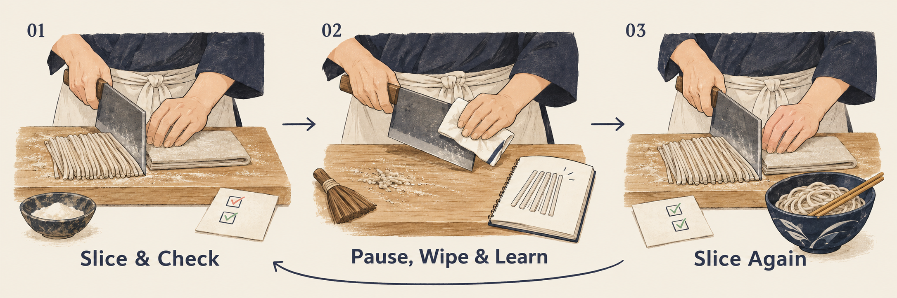
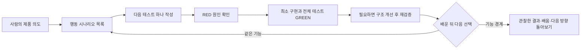

<div align="center">


### Sobaya

실패하는 테스트가 먼저, 에이전트는 그다음.

[English](README.md) · **한국어** · [가이드](docs/guide.md) · [런타임 레퍼런스](tdd-set/README.md) · [계약](AGENTS.md) · [검증 기록](docs/harness-validation.md)

</div>

Sobaya는 켄트 벡의 Canon TDD와 Augmented Coding 흐름을 따르는 개발
워크스페이스입니다. 사람은 제품의 의도를 결정하고, 에이전트는 그 범위 안에서
테스트 하나를 작성해 RED를 확인하고 GREEN으로 만든 뒤 필요한 구조를 정리합니다.
테스트마다 별도 승인을 받거나 미래 테스트를 묶음으로 고정하지 않습니다.
앱은 `apps/<name>`의 독립 Git 저장소에 놓입니다.



**조금 만들고 확인합니다. 멈춰서 배우고 정리합니다. 다음 변경을 선택합니다.**

소바를 써는 사이에 칼을 닦듯, 기능을 만드는 시간과 변경할 여지를 되찾는 시간을
번갈아 갖습니다. 이 리듬은 [켄트 벡의 발표](https://www.rise8.us/videos/kent-beck-software-engineering-in-the-age-of-ai)에서 가져왔습니다.

## 개발 흐름



1. 사람의 의도를 읽고 행동 시나리오를 `failed-test.md`에 정리합니다.
2. 다음 테스트 하나만 구체화하고 의도한 이유로 실패하는지 확인합니다.
3. 최소 구현으로 새 테스트와 기존 테스트를 통과시킵니다.
4. GREEN에서 필요한 소스·테스트 리팩터링을 하고 전체 테스트를 다시 실행합니다.
   동작 변경과 구조 변경은 별도 커밋으로 남깁니다.
5. 배운 내용에 따라 미래 시나리오를 추가·수정·재정렬하고 다음 테스트를 선택합니다.
6. 기능 사이에는 실제 관찰한 결과와 불확실성, 다음 선택을 돌아봅니다.
   회고 문서나 리팩터링을 억지로 만들 필요는 없습니다.

테스트 코드의 개별 승인, 영구 고정, 다음 테스트의 추가 승인, 필수 독립 리뷰는
없습니다. 기대하는 제품 동작이 불명확하거나 달라질 때 사람에게 묻습니다.
실패를 숨기려고 테스트를 삭제·비활성화하거나 기대값을 실제값에 맞추지 않습니다.

## 선택해서 쓰는 셸 도구

에이전트가 앱에서 직접 TDD를 수행할 수 있습니다. `step.sh`는 다음 테스트의
삽입·실패 확인·구현 위임·전체 검증·커밋을 도와주는 선택 도구입니다.
미래 시나리오는 문장으로 두고, 현재 실행할 테스트 하나만 코드로 붙입니다.
[런타임 예시](tdd-set/README.md#scenario-list-and-the-next-test)를 참고하세요.

```sh
bash scripts/setup.sh .
tdd-set/bin/install.sh apps/example
# 사람이 spec.md를 작성합니다. 에이전트가 시나리오와 다음 테스트 하나를 준비합니다.
tdd-set/bin/step.sh apps/example
tdd-set/bin/status.sh apps/example
# GREEN에서 정리한 뒤 현재 코드를 확인합니다.
tdd-set/bin/gate.sh apps/example
```

`loop.sh`도 한 테스트 뒤에 돌아옵니다. 오케스트레이터가 배움과 다음 선택을
판단한 뒤 계속합니다. `review.sh`는 필요할 때 사용하는 선택 도구입니다.
기존 승인 상태와 묶음 플랜은 `migrate.sh APP`으로 원본·실행 이력을 보관하면서
시나리오 목록으로 바꿉니다. Sobaya 업데이트가 앱들을 일괄 수정하지는 않습니다.

## 버전별 설치 (v1 개발 중)

`bin/sobaya config check --root PATH`는 작업 공간의 `sobaya.json`과 JSON
형식의 `sobaya.lock`을 읽습니다. 명시한 `project`/`dependency` 모드, 정확한
버전과 lock 필드를 검사하고 JSON 객체 하나를 출력합니다. 입력 오류는 종료
코드 2와 stderr 진단으로 보고하며 stdout은 비워 둡니다. 작업 공간을 보존하고
배포 파일 검증이나 설치는 수행하지 않습니다.

로컬 배포 묶음은 `bash scripts/package-release.sh`에 `--source`, `--version`,
`--commit`, `--output`을 명시해 만듭니다. 일치하는 로컬 버전 태그가 필요하며,
원본 밖의 새 디렉터리에 런타임 압축 파일과 SHA-256 매니페스트를 생성합니다.
[승인한 명령과 파일 범위](docs/plans/sobaya-v1-release-review.md)를 참고하세요.
원본과 기존 출력 경로를 보존하며 게시나 설치는 수행하지 않습니다.

`bash tdd-set/lib/install-runtime.sh`는 별도로 신뢰한 매니페스트와 배포 파일을
검증해 소비 작업 공간 밖에 버전별로 설치합니다. 설치된 `bin/sobaya`는 `init`,
`sync`, 기존 실행 명령, 명시적 `bump`를 지원하며 각각 `--root`와
`--install-root`를 받습니다. 프로젝트 모드는 기존 `apps/<name>` 저장소를,
종속 모드는 소비 저장소 자체를 연결합니다. 모드와 고정 버전은 작업 공간별입니다.

`bump`는 연결된 모든 앱의 전체 테스트와 포맷·린트 검사로 후보 버전을 검증하고,
실행·사용량 기록을 보존합니다. 성공하면 설정 두 파일을 검토용 변경으로 남기고,
검증 실패 시 복구하며, 진행 중인 항목이 있으면 거부합니다. 기존 지침과 지원하는
Git 훅도 보존합니다. 명령과 제약은 [설치 안내](docs/installed-runtime.md)에
있습니다. 위의 소스 체크아웃 방식도 계속 사용할 수 있습니다. Canon TDD에는
이번 변경을 포함한 런타임 배포본이 필요하며, 이전 v1.0.0-rc.1의 동작은 그대로입니다.
이전 실행기와의 호환성 및 남은 출시 검증은 설치 안내를 참고하세요.

## 실행과 검증

하네스는 Bash 3.2·jq·Git·표준 Unix 도구를 사용합니다. Go·Node·로컬 Vitest는
앱 테스트용입니다. 다른 하네스 런타임 언어를 도입하려면 명시적 승인이 필요합니다.
기본 작업자는 Codex의 Astra이며 모델 정책·호출 한도·시간 제한은 계속 적용됩니다.
체크아웃 하나에는 작성자 하나만 둡니다.

실행 중인 RED→GREEN 단계에서는 구현 작업자가 테스트나 명세를 바꿀 수 없습니다.
GREEN 이후에는 동작을 보존하는 테스트 리팩터링도 가능합니다. 전체 테스트 통과는
실행 증거이며, 사용자 가치나 테스트의 의미가 완전함을 자동으로 보증하지 않습니다.

`bash tests/run.sh`는 실제 Git·테스트 러너와 가짜 작업자를 사용하는 로컬 검증이며
유료 모델을 호출하지 않습니다. 이전 승인 방식의 테스트는 역사 자료로 보관됩니다.
[가이드](docs/guide.md)와 [런타임 레퍼런스](tdd-set/README.md)에 전환·복구 방법이 있습니다.

## 구성과 출처

- `AGENTS.md`: 공통 계약. 유지보수 권한은 모델 이름이 아니라 작업 범위에서 나옵니다.
- `tdd-set/`: 개발 사이클, 선택 실행 도구와 스택 스킬.
- `.agents/skills/`: 오케스트레이션·회고·지식 관리.
- `brain/`: 필요한 때 읽는 지속 지식.
- `docs/`: 한국어 사용자 가이드와 역사 기록.

개발 사이클은 [Canon TDD](https://newsletter.kentbeck.com/p/canon-tdd)와
[Augmented Coding](https://newsletter.kentbeck.com/p/augmented-coding-beyond-the-vibes)을
따릅니다. 셸 도구는 소바야의 구현이며 벡이 요구한 절차는 아닙니다.
초기 개발 규칙의 역사적 출처는 BPlusTree3 `rust/docs/CLAUDE.md`의 `e1f539e`입니다.
워크스페이스 기억과 격리 방식은 [noodle](docs/from-noodle.md)에서도 영향을 받았습니다.
