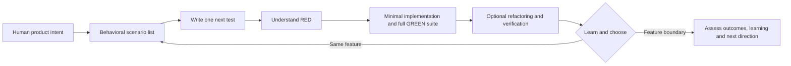

<div align="center">


### Sobaya

Failing tests first, then the agent.

**English** · [한국어](README.ko.md) · [Guide](docs/guide.md) · [Runtime reference](tdd-set/README.md) · [Contract](AGENTS.md) · [Validation report](docs/harness-validation.md)

</div>

Sobaya follows Kent Beck's Canon TDD and augmented coding practice. The
human owns product intent; agents write one test, observe RED, implement GREEN,
and optionally improve the design. Tests need no separate approval and future
cases are not frozen into executable batches. Apps live in independent Git
repositories at `apps/<name>`.


**Make a little and check it. Pause to learn and tidy. Choose the next change.**

Like wiping the knife between cuts, alternate between adding features and
restoring room for change. This rhythm draws on
[Kent Beck's talk](https://www.rise8.us/videos/kent-beck-software-engineering-in-the-age-of-ai).

## Workflow



1. Read product intent and list behavioral scenarios in `failed-test.md`.
2. Concretize only the next test and inspect its intended failure.
3. Make that test and previous tests pass with the smallest coherent change.
4. At GREEN, optionally refactor source and test code, rerunning the full suite.
   Keep structural and behavioral changes in separate commits.
5. Add, revise or reorder future scenarios from what you learned; choose again.
6. Between features, assess observed outcomes, uncertainty and the next choice.
   No forced retrospective document or refactor is required.

Exact-test approvals, permanently frozen tests, append approvals and mandatory
independent reviews are removed. Consult the human when expected product
behavior is unclear or changing. Never delete/disable tests or substitute
actual output into expected values to manufacture a pass.

## Optional shell helpers

The agent can run TDD directly in app files. `step.sh` optionally handles test
insertion, RED evidence, implementation delegation, full verification and a
behavioral commit. Attach code only for the current test; leave future cases
as prose. See the [runtime example](tdd-set/README.md#scenario-list-and-the-next-test).

```sh
bash scripts/setup.sh .
tdd-set/bin/install.sh apps/example
# Human fills spec.md; agent lists scenarios and prepares one next test.
tdd-set/bin/step.sh apps/example
tdd-set/bin/status.sh apps/example
# After useful GREEN tidying, check current code.
tdd-set/bin/gate.sh apps/example
```

`loop.sh` also returns after one test. The orchestrator learns and chooses
before continuing. `review.sh` is optional when useful. Existing approval
state/batch plans use `migrate.sh APP`, preserving originals and execution
history while converting the plan to scenarios. Updating Sobaya does not
mass-modify app repositories.

## Versioned installations (v1 development)

`bin/sobaya config check --root PATH` reads the workspace's `sobaya.json`
and JSON `sobaya.lock`. It validates the explicit `project`/`dependency` mode,
exact version and matching lock fields, then prints one JSON object. Invalid
input returns exit 2 with a diagnostic on stderr and no stdout. It preserves
the workspace and does not verify or install release artifacts.

Local release packaging is also available through `bash scripts/package-release.sh`
with explicit `--source`, `--version`, `--commit` and `--output` arguments.
It requires a matching local version tag and creates a runtime archive plus a
SHA-256 manifest in a new directory outside the source. See the
[approved command and file scope](docs/plans/sobaya-v1-release-review.md).
The source and existing output paths are preserved; it does not publish or install.

`bash tdd-set/lib/install-runtime.sh` verifies a separately trusted manifest and
release archive, then installs an isolated version outside the consumer. The
installed `bin/sobaya` supports `init`, `sync`, the existing runtime commands,
and explicit `bump`; each takes `--root` and `--install-root`. Project mode
connects existing `apps/<name>` repositories; dependency mode connects the
consumer repository itself. Modes and pins belong to each consumer workspace.

`bump` validates the candidate with every connected app's full suite and hygiene
checks, preserving execution history and usage. It leaves the two pin files for review
on success, restores them on validation failure, and refuses active entries.
Existing instructions and supported Git hooks are preserved. See the
[installation guide](docs/installed-runtime.md) for commands and constraints.
The source-checkout workflow above remains available. Canon TDD needs a runtime
release containing this change; the earlier v1.0.0-rc.1 retains its old behavior.
See the guide for old launcher compatibility and remaining release checks.

## Execution and verification

The harness uses Bash 3.2, jq, Git and standard Unix tools. Go/Node/local Vitest
execute app tests. Another harness runtime language still needs explicit user
approval. The default worker remains Astra through Codex; explicit model
policies, call budgets and timeouts remain. Each checkout has one writer.

During an active RED-to-GREEN attempt, an implementation worker cannot alter
tests or intent. At GREEN, behavior-preserving test refactoring is allowed.
Passing tests supply execution evidence, not automatic proof of user value or
complete semantic coverage.

`bash tests/run.sh` exercises real Git/test runners with fake workers and no
paid model calls. Prior approval-contract tests are retained as history.
The [guide](docs/guide.md) and [runtime reference](tdd-set/README.md) describe
migration and recovery.

## Layout and attribution

- `AGENTS.md`: shared contract; maintenance authority comes from task scope.
- `tdd-set/`: development cycle, optional shell helpers and stack skills.
- `.agents/skills/`: orchestration, reflection and knowledge maintenance.
- `brain/`: durable knowledge, read when relevant.
- `docs/`: Korean user guides and historical records.

The cycle follows [Canon TDD](https://newsletter.kentbeck.com/p/canon-tdd) and
[Augmented Coding](https://newsletter.kentbeck.com/p/augmented-coding-beyond-the-vibes).
The shell helpers are Sobaya's implementation, not procedures required by Beck.
The historical source of the first development rules was BPlusTree3
`rust/docs/CLAUDE.md` at `e1f539e`. Workspace memory and isolation practices
also drew on [noodle](docs/from-noodle.md).
